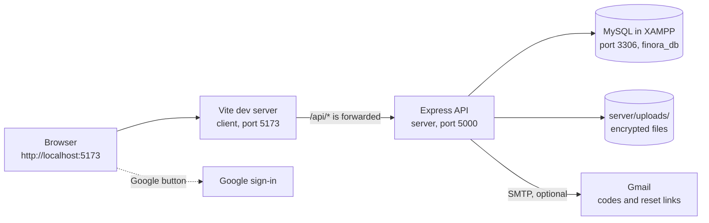
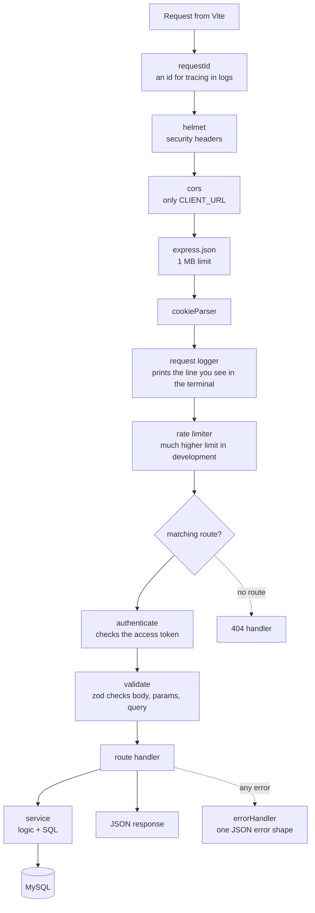
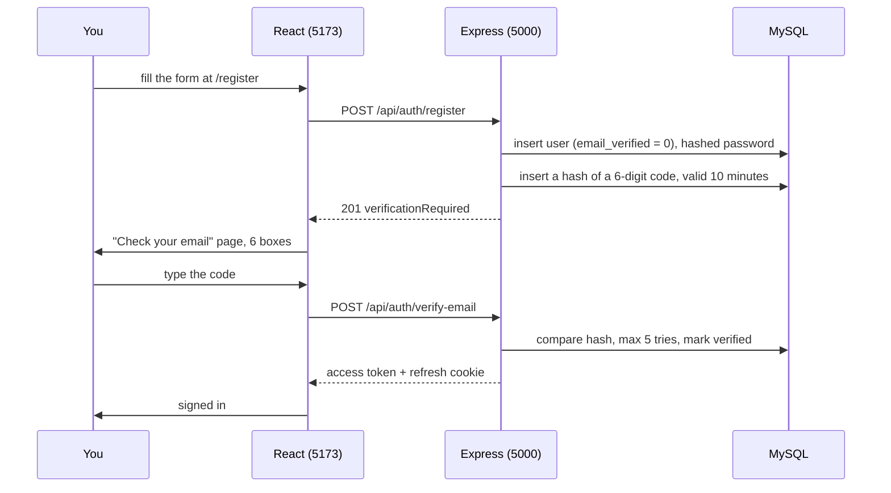
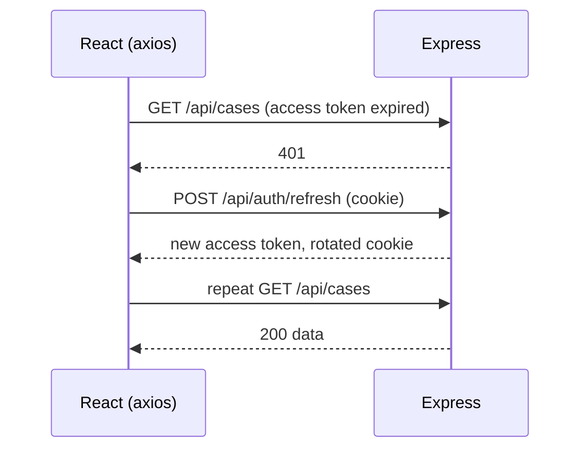
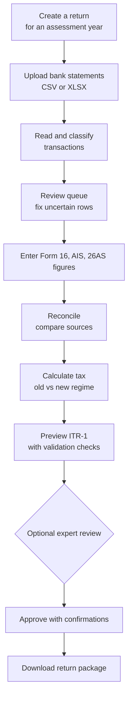

# Finora on localhost: how it works, request by request

This file explains Finora running on your own PC (XAMPP). It follows one request from the browser to the database and back, using localhost addresses only.

---

## 1. What runs on your PC



| Part | Port | Started by | Folder |
|---|---|---|---|
| MySQL | 3306 | XAMPP Control Panel, Start next to MySQL | database `finora_db` |
| API (Node + Express) | 5000 | `npm run dev` in `server` | `server/src/` |
| Website (React + Vite) | 5173 | `npm run dev` in `client` | `client/src/` |

You open **http://localhost:5173** in the browser. That is the only address you use. The page itself comes from Vite; every call that starts with `/api` is forwarded by Vite to `http://localhost:5000` (this is set in `client/vite.config.js`). The browser never talks to MySQL.

**Start order:** MySQL, then `cd server && npm run dev`, then `cd client && npm run dev`.

---

## 2. What happens when you open a URL

### 2.1 A page, for example `http://localhost:5173/login`

1. The browser asks Vite for `/login`.
2. Vite sends back `index.html` and the React code. `/login` is not a real file; React Router reads the address and shows the Login screen.
3. Moving between pages later happens inside the browser; nothing is reloaded.
4. When the app starts it calls `POST /api/auth/refresh` once to see whether you already have a session (section 4.2). A loader shows until it answers.

### 2.2 An API call, for example `GET http://localhost:5173/api/cases`

1. The React code calls axios with `baseURL: '/api'`, so the call goes to `localhost:5173/api/cases`. It carries `Authorization: Bearer <access token>` and cookies.
2. Vite sees the `/api` prefix and forwards it to `http://localhost:5000/api/cases`.
3. Express handles it (section 3) and returns JSON.
4. Vite hands the JSON back to the browser.

Because both go through port 5173, the browser sees one site, so cookies and CORS are not a problem.

---

## 3. Inside the API: the life of one request

The order is set in `server/src/app.js`:



Key ideas:

- **One folder per feature** in `server/src/modules/<feature>/`: `*.routes.js` (URLs and middleware), `*.service.js` (logic and SQL), sometimes `*.schema.js` (input rules).
- **`authenticate`** reads the Bearer token, verifies it, and sets `req.user = { id, role }`. Only tokens of type `access` are accepted.
- **`validate`** rejects bad input with `400` and a list of field errors that the form shows under each field.
- **Ownership** is enforced inside the SQL (`WHERE id = :caseId AND user_id = :userId`), so one user can never read another user's data.
- **Errors** are thrown as `AppError(status, code, message)`. `errorHandler` turns them all into `{ "error": { "code", "message" }, "requestId" }`, and the app shows `message`.
- **Database access** uses a connection pool with named placeholders (`:userId`), never values pasted into SQL. Money is calculated in integer paise.

Example of what you see in the API terminal while you click around:

```
POST /api/auth/login 200 85 ms
GET  /api/cases 200 12 ms
POST /api/cases/3/documents 201 140 ms
```

---

## 4. Accounts and sign-in (localhost example)

### 4.1 Register with email verification



**Where do you find the code on localhost?** If `MAIL_PASSWORD` is empty in `server/.env`, the email is not sent. The API prints it in the terminal that runs `npm run dev`, in a line like `mail (not sent...)` with `"subject":"123456 is your Finora verification code"`. If `MAIL_PASSWORD` is set, the real email arrives in the inbox.

Rules: a code works once, lasts 10 minutes, allows 5 wrong tries, and can be re-sent once a minute. An unverified account cannot sign in: the password check passes, then the API answers `403 EMAIL_NOT_VERIFIED`, sends a new code, and the app opens the code page.

### 4.2 Sessions: access token and refresh cookie

| Token | Lives | Stored | Purpose |
|---|---|---|---|
| Access token | 15 minutes | browser memory only | sent as `Authorization: Bearer` on each call |
| Refresh token | 30 days | `httpOnly` cookie `finora_rt`; only its hash is in table `login_sessions` | gets a new access token |



- Several calls that fail at once share **one** refresh call.
- Every refresh replaces the token. Re-using an old one after a 10-second grace is treated as theft and signs out all sessions.
- Logout, password change and password reset revoke sessions.
- Five wrong passwords lock the account for 15 minutes.

### 4.3 Sign in, Google, two-factor, forgot password

- **Password sign-in:** `POST /api/auth/login`. With two-factor on, the API first answers `{ mfaRequired, mfaToken }`; you then enter an authenticator code or a backup code, and `POST /api/auth/mfa/verify` creates the session.
- **Google sign-in:** the Google button gives the browser an ID token; the browser sends it to `POST /api/auth/google`; the API verifies it with Google against `GOOGLE_CLIENT_ID`, then signs you in, creates the account, or links it to the same email. On localhost, `http://localhost:5173` must be listed under *Authorized JavaScript origins* in your Google client.
- **Forgot password:** `POST /api/auth/forgot-password` always answers `204`. The reset link (valid 30 minutes, single use) is emailed or, without `MAIL_PASSWORD`, printed in the API terminal as `http://localhost:5173/reset-password?token=...`. Opening it and saving a new password signs out all sessions and returns you to `/login` with a success message.

---

## 5. The filing journey



Step by step, with the module that owns each step:

1. **Profile and eligibility** (`profile`, `taxfacts`, `tax`). Name, PAN (validated, stored encrypted, only the last four digits shown), date of birth, residency. A short questionnaire checks the return is supported.
2. **Upload** (`documents`). The file is checked for size and real type (from its bytes, not its name), scanned through the malware hook, checked for duplicates, then **encrypted with AES-256-GCM** and saved in `server/uploads/`. It is downloaded only through short-lived signed links.
3. **Process** (`ledger`). The parser finds the header row and reads dates, amounts and balances into `bank_transactions`. It warns if dates fall outside the chosen financial year.
4. **Classify** (`classification`). Rules give each transaction a category, a confidence and a plain reason. Uncertain rows go to the **review queue**. Your corrections are kept when a statement is processed again.
5. **Reconcile** (`reconciliation`). Bank salary, Form 16, AIS and 26AS are compared; differences become items you resolve with a note.
6. **Calculate** (`tax`). A deterministic calculator uses versioned rule sets stored in the database (AY 2025-26, 2026-27): slabs, 87A rebate, 80C and 80D caps, cess, rounding. Both regimes are shown with their working. The result is labelled an estimate.
7. **Preview** (`itr`). Figures are mapped to ITR-1 sections and checked at four levels (structure, arithmetic, business rules, cross-document). Blocking problems stop approval.
8. **Approve** (`itr`). You tick confirmations; a SHA-256 fingerprint of the return is saved. If any figure changes later, the approval is withdrawn automatically.
9. **Export** (`itr`). A JSON package in Finora's own format, marked `official: false`. Finora does not e-file.

The Start page (`filing`) shows progress, the next step, and insights such as notice risk and missed deductions.

---

## 6. Expert review (localhost example)

1. As a customer, open a return preview and click **Request expert review**. While a review is open you cannot approve.
2. Create a staff account in `server`: `npm run user:staff -- expert@example.com "Test Expert" expert`. It prints a temporary password. Sign in with it, then turn on two-factor in Settings. Experts cannot see anything without it.
3. The expert opens `http://localhost:5173/expert`, picks up the review (only one expert can), sees the return read-only with the PAN masked, and chats with you.
4. The expert approves or asks for changes. If you change figures after an approval, the app shows it as out of date.
5. Every expert view and decision is written to the audit log (`audit_events` table).

---

## 7. Notifications, privacy, security

- **Notifications:** created when a document is processed, a return is approved or withdrawn, and when reviews move. The bell calls `/api/notifications/unread-count` on every page change.
- **Your data:** Settings lets you download everything as JSON, clear all returns, or delete the account (password required).
- **Security layers:** helmet headers, strict CORS, rate limits, bcrypt password hashes, typed JWTs, AES-256-GCM for files and PAN, zod validation on every input, parameterised SQL, audit log, lockout, two-factor with backup codes, email verification.

---

## 8. Frontend structure

```
client/src/
  api/         http.js (axios and refresh logic), services.js (one object per backend area)
  context/     AuthContext (current user, login, logout, verify)
  hooks/       useFetch, useForm, useUploadQueue, useUnreadCount ...
  components/  ui/ (Button, Field, Card, Modal), layout/, filing/, itr/, settings/, review/
  pages/       one file per screen (Login, Register, VerifyEmail, Dashboard, Documents ...)
  styles/      tokens.css (colours, radius), then one css file per area
```

- The app shell is a left sidebar (Home, Documents, Analysis, Tax summary, ITR) with a slim top bar; phones get a bottom tab bar. Dropdowns and dates use `ui/Select.jsx` and `ui/DatePicker.jsx` (bottom sheets on phones) instead of the browser's own controls.
- `App.jsx` holds the routes. `ProtectedRoute` needs a user, `RoleRoute` keeps customers and staff apart, `GuestRoute` keeps signed-in users off the sign-in pages.
- Pages load data with `useFetch`, which shows a loader, an error with a retry button, or the content.
- Forms use `useForm`: validate on blur, show server errors under the right field.
- Colours come from CSS variables in `tokens.css` (navy `#0f2557`, blue `#2f5bea`, teal `#14b8a6`). Layouts work from 320 px wide up.

---

## 9. Settings in `server/.env` (localhost values)

| Variable | Localhost value |
|---|---|
| `NODE_ENV` | `development` |
| `PORT` | `5000` |
| `CLIENT_URL` | `http://localhost:5173` |
| `DB_HOST`, `DB_USER`, `DB_PASSWORD`, `DB_NAME` | `127.0.0.1`, `root`, empty, `finora_db` (XAMPP defaults) |
| `JWT_SECRET` | any random string of 32+ characters |
| `DATA_ENCRYPTION_KEY` | 64 hex characters. **Do not change it later**, or old files cannot be opened |
| `GOOGLE_CLIENT_ID` | your Google client id (optional) |
| `MAIL_*` | Gmail settings. Leave `MAIL_PASSWORD` empty to just print emails in the terminal |

`server/.env` is read when the API starts. After editing it, stop `npm run dev` with Ctrl+C and start it again.

---

## 10. Running and testing on localhost

```
# 1. XAMPP Control Panel: start MySQL
# 2. First time only, create the tables:
cd server
npm install
npm run db:init

# 3. API
npm run dev            # http://localhost:5000, restarts on code changes

# 4. Website (second terminal)
cd client
npm install
npm run dev            # http://localhost:5173  <- open this in the browser
```

Quick checks:

- `http://localhost:5000/api/health` should show `{"status":"ok"...}`.
- `http://localhost:5000/api/health/ready` should show the database and tax rules as `true`.
- To look at the data, open phpMyAdmin at `http://localhost/phpmyadmin` and choose `finora_db`.

Tests (in `server/`):

- `npm test` runs the unit tests.
- `npm run test:integration` runs real-database tests (MySQL must be running). They create their own users and remove them afterwards.

---

## 11. When something breaks on localhost

| Symptom | Likely cause and check |
|---|---|
| `localhost:5173` refuses the connection | `npm run dev` is not running in `client` |
| Red errors or `ECONNREFUSED` for `/api/...` | The API is not running or crashed; look at the `server` terminal |
| API says it cannot connect to the database | MySQL is not started in XAMPP, or `DB_*` in `.env` is wrong |
| MySQL will not start in XAMPP | Look at `C:\xampp\mysql\data\mysql_error.log`; always press Stop in XAMPP before shutting down the PC |
| "Something went wrong" on sign-in | Browser DevTools, Network tab, open the failed request and read the response; the `requestId` also appears in the API log |
| No verification email | With an empty `MAIL_PASSWORD` the code is in the API terminal; with a password set, check it and the spam folder |
| Google button shows "origin is not allowed" | `http://localhost:5173` is missing in Google Cloud Console, Authorized JavaScript origins |
| Everyone is signed out after restarting | `JWT_SECRET` changed |
| Uploaded files unreadable | `DATA_ENCRYPTION_KEY` changed |

---

## 12. Known limits

- No PDF or scanned statements yet; Form 16, AIS and 26AS figures are typed in.
- The export is Finora's own format, not the official ITR JSON, and there is no e-filing.
- The tax rules have not yet been verified by a tax professional.
- No AI assistant yet.
